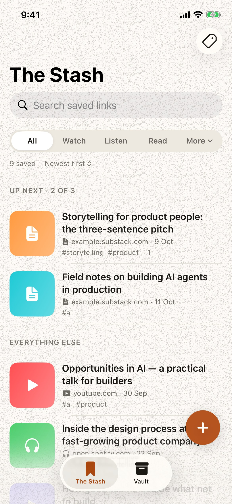
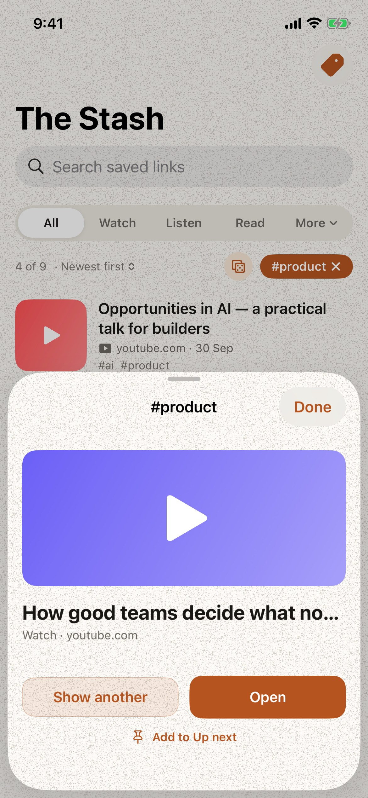
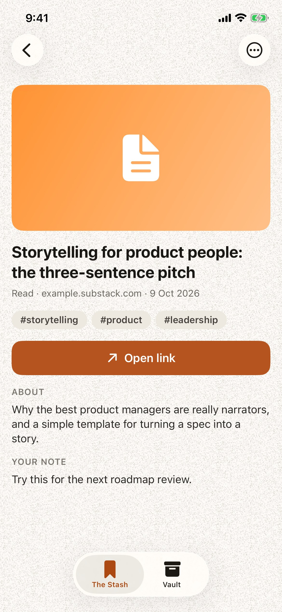
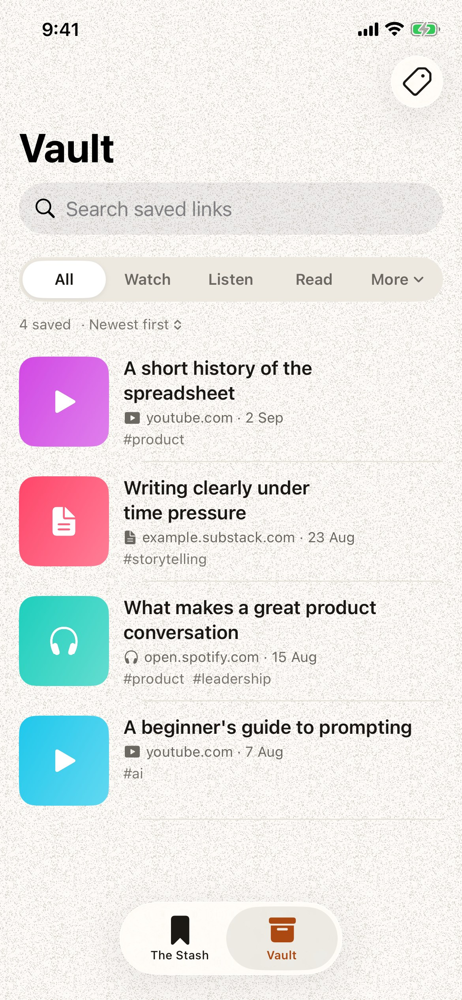
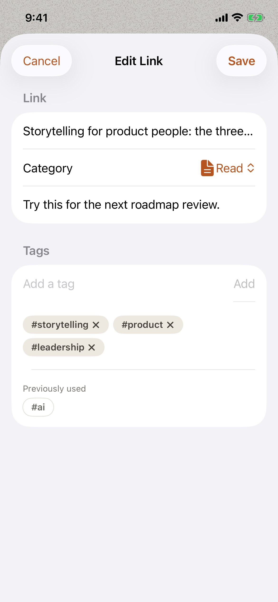

# Stash

Save any link — a podcast, a YouTube video, a Spotify audiobook, a restaurant, a LinkedIn or X post — with its title, image, and a preview of the content pulled in automatically, so you don't forget about it. Tag it, pin the few things you want to get to next, search it, mark it done once you've actually checked it out, and let Stash pick something for you when you can't decide. Add links from inside the app, or straight from the Share Sheet in Safari/YouTube/Instagram/etc.

  
  
  

  
  

*(Screenshots use generated sample links, not real personal data.)*

## How it works

- **The Stash / Vault** tabs — your saved links, split by whether you've gotten to them yet. Marking a link done moves it to the Vault — a keep pile, not a delete pile. Filter by type with the one-row picker up top (All / Watch / Listen / Read, with Socials / Visit / Buy / Other under *More*); a quiet count shows what's visible, and a small menu next to it switches between newest-first and oldest-first.
- **Search** — pull down for the search field; it looks across titles, sites, tags, notes and the fetched preview text, and works together with the type and tag filters.
- **Up next** — pin up to three links (swipe right on a row, long-press it, or use the **⋯** menu on a link) and they sit in their own section at the top of The Stash. Pin a fourth and the oldest pin quietly drops out; marking a link done un-pins it.
- **Surprise me, per tag** — filter by a tag and a small dice appears next to the active tag. Tap it for a random unfinished link with that tag, with *Show another*, *Open* and *Add to Up next*. It's hidden until you're already looking at a tag, so there's no extra clutter.
- **Add a link** (the + button, or the Share Sheet from any app) — Stash fetches a title and thumbnail automatically. YouTube and X/Twitter go through their own public oEmbed APIs for accurate titles and (for X) the actual post text; everything else uses Apple's LinkPresentation framework, the same engine behind Messages/Safari link previews. LinkedIn/Instagram/Facebook posts get their poster's name as the title and, best-effort, a caption preview. Category is guessed from the URL/domain and always editable. A publish date is picked up where the source exposes one (reliable for X; best-effort elsewhere via common meta tags).
- **Share Sheet**: tap *Share* from inside YouTube/Instagram/Safari/etc. and send straight to Stash — no need to copy/paste a URL. Handles both proper link shares and apps (like YouTube) that share plain text with a URL embedded in it.
- **Tap a link** to see the full preview with a single **Open link** button (the image opens it too), the fetched preview text, your own note and tags. Edit, Add to Up next, Mark done and Delete live in the **⋯** menu.
- **Edit anything** — choose **Edit** from a link's **⋯** menu to fix up the title, category, note, or tags after the fact. Changes only apply on Save, so Cancel always discards them, no matter what you typed.
- **Tags** are free-form and cut across categories and source apps — tag a podcast episode and a saved article both "product" if that's how you think about them. Add tags from the Edit sheet (previously-used tags show up as one-tap suggestions); the tag button in the list's toolbar filters by tag, and works together with the type picker.
